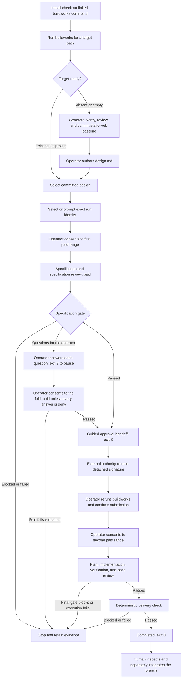

# Runbook: Set up a project and deliver a feature with BuildWorks

**Audience:** Developers, project owners, and operators using the local CLI.
**Applies to:** The checkout-linked guided CLI and advanced low-level commands,
using PowerShell on Windows.
**Maintainer:** BuildWorks maintainers; update this runbook when operator commands,
approval transport, or setup requirements change.

This runbook takes a new or existing local project from guided setup to a
retained, reviewed delivery branch. BuildWorks sequences the stages and records
their evidence; the operator owns the requirements, each spending consent,
external approval signature, and release decision.

The concrete initializer creates only a static-web starter. BuildWorks does not
publish to GitHub, merge a branch, deploy, sign, or repair an interrupted run.
Claude Code is the implemented harness; selecting a different model does not
select another harness. The commands below are operator instructions, not
authorization for an agent to spend money or sign on your behalf.

## Workflow and decision boundaries



One execution consent covers every group in that invocation's preview, including
bounded internal remediation, until approval or terminalization. It is not
single-stage consent, a hard dollar cap, signature authority, or consent to a
later invocation. There is no voluntary stop-after option.

## Guided procedure

### 1. Install the checkout-linked command

Use Node 24 or newer, npm, Git with a commit identity, the native Claude
Code executable on `PATH`, and a running Docker engine (Docker Desktop on
Windows). Every run that reaches implementation runs the implementer's tools,
the verification commands and the derived commands in a container built from
the checkout's `container/Dockerfile`; `new-run` refuses without an engine
before any spend. The image provides Node, npm and Git, plus the Playwright
browser that only the system's acceptance runner uses, and reaches only the npm
registry, so this build supports Node/npm targets; the README's "Docker and the
supported toolchain" states what the program check cannot see. Arrange
authorized Claude provider access and model entitlement separately. Obtain the BuildWorks repository through your normal
Git workflow, then run:

```powershell
$ErrorActionPreference = 'Stop'
$PSNativeCommandUseErrorActionPreference = $false
$BuildWorksCheckout = (Resolve-Path -LiteralPath (Read-Host 'Absolute path to the BuildWorks checkout')).Path
Set-Location -LiteralPath $BuildWorksCheckout
npm install
if ($LASTEXITCODE -ne 0) { throw 'BuildWorks dependency installation failed.' }
npm install --global $BuildWorksCheckout
if ($LASTEXITCODE -ne 0) { throw 'BuildWorks checkout-link installation failed.' }
buildworks --help
bw --help
```

Both aliases point into the complete retained checkout. This is not a packed
or published installation. Moving or deleting the checkout breaks the links
and removes runtime assets such as migrations.

### 2. Configure the external public key and the narration check

Obtain the PEM Ed25519 public key from the separate approval authority and
configure it before run intake:

```powershell
$env:BW_APPROVAL_PUBLIC_KEY = 'C:\Public Approval Material\approval.pub'
```

The matching private key must remain outside the filesystem and process
identity available to the BuildWorks host. Verification runs in a container,
but the agent sessions run on the host as you. Do not store the private key
under the same user profile, place it in either repository, give it to an
agent, or invoke a signer from guided mode.

Guided mode always creates runs with the narration check on. Specification
review then asks your Decision-1 deployment whether each acceptance criterion
carries the author's remark about the document or the work, and a flagged
criterion becomes a finding the reconciler answers. Set the four variables in
the same terminal before intake; the values are placeholders for your resource:

```powershell
$env:SYSTEMONE_ENDPOINT = 'https://<your-resource>/<path>'
$env:SYSTEMONE_DEPLOYMENT = '<deployment name>'
$env:SYSTEMONE_DEPLOYMENT_TYPE = '<deployment type>'
$env:SYSTEMONE_API_KEY = Read-Host -MaskInput 'Decision-1 API key'
```

Intake freezes the endpoint, deployment and type, and refuses when any of the
four is unset. The key is read when specification review runs, sent only in the
request header, and never frozen, retained or printed. Any failed Decision-1
request blocks the run. The requests are not counted in the dispatch ceilings or
the reported cost.

### 3. Initialize or select the project

Run the same command for an absent, empty, or existing target:

```powershell
$Target = Read-Host 'Absolute path to the target project'
buildworks $Target
```

An empty child directory inside an existing worktree resolves to that existing
project; the CLI never creates a nested repository.

The path argument must be absolute or explicitly relative — `.`, `..`, or a
`.\` or `./` prefix. A bare name such as `myproject` is parsed as a command
name and refused with exit 2. Running `buildworks` with no argument targets the
current directory.

#### Initialize a new project

The initializer runs for an absent path or a standalone empty directory. It
preflights `node`, `npm`, `git`, and a bounded native Claude Code version probe,
and refuses with `project preflight failed: <check>: <evidence>` before writing
anything if any of them fails. It then prompts, in this order:

| Prompt | Answer |
| --- | --- |
| Project type | Type `static-web`. No other value is accepted, and three invalid answers end the command. |
| Feature slug | The first feature's lowercase kebab-case slug. It names the design directory and becomes the run's frozen slug. |
| Git author name and email | Asked only when the repository has no resolvable commit identity. Answers are written repository-local, never to your global Git configuration. |
| Commit the generated baseline | Read the displayed staged diff first, then type `yes`. Any other answer aborts and leaves the generated files staged for inspection. |

BuildWorks initializes Git when needed and writes exactly this baseline:

| Generated path | Contents |
| --- | --- |
| `.gitignore` | Ignores the machine-local governance directory and `node_modules`. |
| `governed.yaml` | The verification configuration: `npm ci` as `install`, then `npm test` as `test`, and a `derived:` block declaring `package-lock.json`, regenerated by `npm install --package-lock-only --ignore-scripts`. |
| `package.json` and `package-lock.json` | A private ES-module manifest whose `test` script is `node --test`, with a dependency-free lockfile. |
| `index.html` and `src\app.js` | The static-web page and the one module it loads. |
| `test\starter.test.js` | A single placeholder test asserting that the page references that module. |
| `README.md` | The generated project's own three-step instructions. |

It then creates the empty feature directory, parses the generated configuration,
runs the generated `npm ci` and `npm test`, displays the staged diff, and after
your confirmation commits it as `Initialize BuildWorks static-web project`.

The command then prints the exact
`docs\features\<slug>\design.md` path and exits without creating a run. Author
the requested behavior, constraints, exclusions, artifacts, and verification
expectations in that file. Do not hand-author generated `spec.md` or `plan.md`.

If the command is interrupted before the baseline commit, rerunning it resumes
rather than restarting: it writes only missing files and keeps matching ones. It
refuses instead of overwriting — mismatched bytes report `refusing to overwrite
mismatched starter file`, an extra path reports `refusing unrelated path(s) in
the partial starter`, and more than one feature directory refuses as ambiguous.

**Strengthen verification before you spend.** The generated configuration
freezes only `npm ci` and `npm test`, and the only generated test asserts that
the starter page references its module. That gate cannot establish correctness
for the feature you are about to request; see
[Choose meaningful verification before intake](#choose-meaningful-verification-before-intake)
and require the tests you expect in the design itself. Commit a strengthened
`governed.yaml` **after** the guided design commit in step 4. Guided mode
commits only the generated baseline or the design, refuses either commit while
unrelated paths are dirty, and stops offering the design commit once the
committed baseline no longer matches the generated bytes — after that, commit
the design with your normal Git workflow.

#### Select an existing project

For an existing project, BuildWorks resolves the enclosing worktree root and
requires a readable committed HEAD. It selects one committed, nonempty design or
asks among displayed choices. It refuses nonempty non-Git targets, changed
generated starter bytes, unrelated working-tree changes, empty designs, and
ambiguous design choices. An initialized repository with no commit yet is
treated as a new project and receives the starter.

Run intake in step 4 additionally requires a working tree that is clean apart
from the machine-local governance directory, `governed.yaml` committed at the
starting commit, a resolved `BW_APPROVAL_PUBLIC_KEY`, and the four
`SYSTEMONE_*` variables from step 2. Git-ignoring the
governance directory is reported as a `doctor` readiness failure and is strongly
recommended, but intake filters that directory rather than blocking on it.

Guided mode does not run your project's verification commands before the first
paid range. For an existing project, do the
[fresh-worktree check](#prove-the-verification-commands-run-in-a-fresh-worktree-before-you-spend)
yourself before you consent.

### 4. Commit the design and create or resume the exact run

Rerun the same command:

```powershell
buildworks $Target
```

BuildWorks shows and commits only the selected `design.md`. If no persisted
identity tuple exists for that slug, it asks explicitly for project, feature
ID, change kind (`feature` or `defect_fix`), and model. Suggested values are
not silently accepted. Existing tuples are displayed and selected exactly by
project, feature ID, slug, and change kind. The model you enter applies to the
`reconciler` setting only; guided mode passes no other
override, so every other setting takes its seeded model and effort. The paid
range preview lists all of them.

One nonterminal run resumes even if older terminal records exist. More than one
matching nonterminal run refuses. With no nonterminal run, one terminal record
is reported and several terminal records refuse. Guided mode never chooses the
newest record as an implicit tie-breaker.

The command is interactive only. Redirected stdin refuses before mutation or
spend. Review the preview and type `yes` only if you authorize its complete
paid range. Decline, cancellation, or end-of-input starts no dispatch.

### 5. Answer spec-review questions, when asked

Specification review may find a question the design does not answer and that
it judges blocking. Instead of blocking the run, it asks you. The first paid
range then stops before approval, and guided mode shows each question with its
numbered options, the recommended option, and the reviewer's reason:

| Answer | Effect |
| --- | --- |
| `1` | Approve: records the recommended option's answer. |
| `2` | Deny: the question stays open, the spec says nothing new about it, and the run continues. |
| `3` | Modify: records your own one-line answer. |
| `4` (default) | Exit with code 3. Answers already given stay recorded; rerun `buildworks $Target` to continue. |

Three invalid entries also exit. Answers are final; a mistaken answer is
repaired by a fresh run. You can also answer from the dashboard or with
`decide` (see [Answer spec-review questions](#answer-spec-review-questions)
below).

After the last answer, guided mode previews the `decision` group and asks for
a separate `yes`. That group dispatches the spec author once to fold your
approved and modified answers into the specification; if every answer is a
deny, it completes without a dispatch. A fold that fails validation blocks the
run. On success the run stops at the approval handoff below, and approval binds
the folded specification.

When the reviewed spec declares more files than the frozen threshold (30 by
default), one of the questions proposes splitting the design into ordered
features. Its menu offers only `1` Split, `2` Build as one (the whole design in
this run, which may still be refused at the plan ceiling), and `4` Exit. Any
other entry is refused and asked again; three refused entries exit with code 3
without recording an answer. An approved split ends the run
blocked instead of stopping at approval; follow
[When BuildWorks proposes a split](#when-buildworks-proposes-a-split) below to
build the features. Guided mode does not offer `--after`, so each feature after
the first starts from the advanced commands.

### 6. Complete the external approval handoff

The first paid range runs specification and specification review and stops at
the valid approval boundary with exit 3. Guided mode exclusively creates the
canonical payload here:

```text
<target>\.governance\approval-handoff\<run-id>\payload.txt
```

Review the specification, declared artifacts, risk, hashes, starting commit,
profile, signer fingerprint, and expiry displayed by BuildWorks. Transfer
`payload.txt` through an approved channel to the external authority. If the
binding is acceptable, that authority signs the exact bytes and returns only
the detached base64 Ed25519 signature. Place it at:

```text
<target>\.governance\approval-handoff\<run-id>\signature.txt
```

When `signature.txt` is not yet present, BuildWorks presents an interactive menu
offering four options:
1. **Approve:** Verifies the detached signature and proceeds if present.
2. **Modify:** Prints guidance for updating requirements in `design.md` and starting a new run.
3. **Reject:** Confirms operator rejection and records an `approval.refused` audit event.
4. **Exit:** Leaves the run cleanly paused to review or sign later.

Once `signature.txt` is placed, rerun `buildworks $Target`. The CLI redisplays
the binding and asks whether to submit the detached signature. After `yes`, it
acquires the repository lock, rechecks the payload, signature bytes, expiry,
public key, and complete binding, then records approval. Any mismatch refuses
without recording approval.

If the canonical payload has expired, rerunning the command atomically
quarantines the complete handoff directory as inert expired evidence and
creates fresh canonical bytes. Any stale signature moves with that evidence but
is never submitted. A malformed expiry or noncanonical payload refuses rather
than being relabeled as an expired handoff.

Approval does not authorize execution. Review the newly displayed paid range
and provide a separate `yes` only if you authorize planning, implementation,
verification, bounded code-review remediation, and delivery checking.

### 7. Inspect and integrate the result

On success the guided result reports the retained branch, worktree, delivered
commit, delivery evidence, final findings count, and known recorded cost.
Exercise the product using its own instructions and inspect the retained
evidence before release. `completed` proves only that frozen gates passed and
every signed declared artifact changed.

Merging, pushing, creating a pull request, and deploying remain separate human
decisions. Preserve `.governance` while its local database, logs, reports, and
raw outputs are needed; a Git push does not back them up.

## Advanced manual command reference

Use the remaining procedure when explicit run IDs, JSON automation, individual
low-level commands, or diagnostic inspection are required. It documents the
same core but does not replace the guided default.

### 1. Prepare the BuildWorks checkout

Use Node 24 or newer, npm, Git with a working commit identity, and the native
Claude Code executable on PATH. Arrange authorized Claude provider access and
model entitlement separately. No GitHub account or remote is needed to operate
an already available local checkout and target.

Obtain this repository through your normal Git workflow. Set the checkout path
to your own location, not another user's machine:

```powershell
$ErrorActionPreference = 'Stop'
$PSNativeCommandUseErrorActionPreference = $false
$BuildWorksCheckout = (Resolve-Path -LiteralPath (Read-Host 'Absolute path to the BuildWorks checkout')).Path
$BwCli = Join-Path $BuildWorksCheckout 'src\cli.ts'
Set-Location -LiteralPath $BuildWorksCheckout

node --version
if ($LASTEXITCODE -ne 0) { throw 'Node must be available.' }
git --version
if ($LASTEXITCODE -ne 0) { throw 'Git must be available.' }
claude --version
if ($LASTEXITCODE -ne 0) { throw 'The native Claude Code executable must be available.' }
```

Install BuildWorks' development dependencies once from that checkout:

```powershell
npm install
if ($LASTEXITCODE -ne 0) { throw 'BuildWorks dependency installation failed.' }
& node $BwCli --help
& node $BwCli help run
```

`npm install` alone does not place this package's own commands on PATH. Use
`& node $BwCli` in this advanced workflow or install the checkout-linked aliases
as shown in the guided procedure. The complete checkout remains necessary
because runtime assets, including migrations, resolve beside the source.

Keep these variables in the same PowerShell session. The native-command setting
lets the examples handle exit codes explicitly, including the expected exit 3;
it has no native-command behavior on older PowerShell versions.

### 2. Prepare a separate target repository

Choose a durable local directory outside the BuildWorks checkout. Avoid temporary
directories that the operating system may remove at logoff. Do not relocate an
in-flight target: retained references can contain absolute paths.

```powershell
$Target = Read-Host 'Absolute path to the target project, not the BuildWorks checkout'
$Project = Read-Host 'Project identifier, for example calculator'
$FeatureId = Read-Host 'Feature identifier, for example calculator-1'
$Slug = Read-Host 'Lowercase kebab-case feature slug, for example web-calculator'
```

For an existing project, use its existing Git worktree. For a new project only,
create the directory and initialize Git:

```powershell
New-Item -ItemType Directory -Path $Target | Out-Null
git -C $Target init
if ($LASTEXITCODE -ne 0) { throw 'Target Git initialization failed.' }
```

Then, for either case:

```powershell
$Target = (Resolve-Path -LiteralPath $Target).Path
$FeatureDirectory = Join-Path $Target "docs\features\$Slug"
New-Item -ItemType Directory -Path $FeatureDirectory -Force | Out-Null
$DesignFile = Join-Path $FeatureDirectory 'design.md'
```

Author the following inputs in the target using your editor:

| Target input | Required preparation |
| --- | --- |
| `.gitignore` | Add `.governance/`, plus applicable dependency and build-output ignores. Do not ignore the design or verification configuration. |
| `governed.yaml` | Declare real project verification commands as described below. |
| `docs\features\<slug>\design.md` | State the desired behavior, users, requirements, constraints, exclusions, and acceptance expectations. The slug must match `$Slug`. |
| Application baseline | Supply any source, package manifest, lockfile, and verification scripts needed to make the intended project build and run. The advanced low-level workflow does not invoke the guided static-web initializer. |

The design should explicitly require any tests or documentation you expect in
the delivery. There is no separate implemented test-authoring or documentation
stage that will fill those gaps later. For a static page that opens from the
worktree, `new-run --acceptance-tests` adds an independently written browser
suite for the acceptance criteria; see the
[README](../../README.md#opt-in-to-acceptance-tests). It does not replace the
tests the design asks for. You do not hand-author generated `spec.md`
or `plan.md` for this workflow.

#### Choose meaningful verification before intake

The following is an example for an npm project with a committed lockfile and
working `test` and `typecheck` scripts, not a universal configuration:

```yaml
verify:
  - name: dependencies
    command: ["npm", "ci"]
  - name: tests
    command: ["npm", "test"]
  - name: typecheck
    command: ["npm", "run", "typecheck"]
```

Use the project's actual commands. The parser accepts only a `verify:` block
with this indentation and key order, unique filename-safe names, and
double-quoted argv tokens. A token cannot contain spaces, quotes, backslashes,
or shell metacharacters; a target directory itself may contain spaces.

When the run may add packages, also declare the lockfile as a derived artifact,
after the `verify:` entries:

```yaml
derived:
  - name: lockfile
    path: package-lock.json
    command: ["npm", "install", "--package-lock-only", "--ignore-scripts"]
```

BuildWorks then runs that command after every implementation and remediation
commit and commits the lockfile itself. No agent writes it, and a spec that
declares it is refused. The command must change nothing but the derived path,
apart from ignored output, which BuildWorks removes. It runs in a container of
the run's image, with the same isolation and network access as verification.

Verification runs in the newly created run worktree, not your original project
directory. Untracked dependencies are not copied there. Include appropriate
dependency setup when required, and make generated outputs ignored so commands
leave tracked files unchanged. Ensure the test command discovers real tests and
does not silently succeed with zero tests.

Commands run as argv in a disposable container over the run worktree, under
bounded time and output limits. The container receives no host environment
variables, mounts only the worktree, and reaches only the npm registry through
a proxy. Dependency installation still executes package scripts inside it. Use
only commands and repositories you are authorized to run.

Version-only commands such as `node --version` do not establish product
correctness. Do not use them as the project's only delivery evidence.

#### Commit the starting state

Stage the intended baseline, design, configuration, and ignore rules explicitly
using your normal Git workflow. Review the staged changes before committing.
For example, after staging the intended files:

```powershell
git -C $Target --no-pager diff --cached --stat
git -C $Target commit -m "Prepare project for governed delivery"
if ($LASTEXITCODE -ne 0) { throw 'Commit the intended starting state before intake.' }
git -C $Target status --short
```

Do not commit secrets or unrelated work. Intake requires a readable HEAD and a
clean working tree. The verification configuration must be committed, not merely
present on disk.

#### Prove the verification commands run in a fresh worktree before you spend

BuildWorks first runs the frozen verification commands after specification,
planning and implementation have been paid for. A command that cannot run in the
run worktree at all, such as one whose tool is not installed, blocks the run at
that point and the spend is lost. The run cannot be retried; a fresh run is the
repair. Nothing in BuildWorks checks this earlier, so check it yourself. It costs
nothing and takes the time the commands take.

`doctor` runs one part of this check for you at no cost: its `sandbox_programs`
row refuses a command whose top-level program the image lacks. It cannot run
the commands. Create a throwaway worktree of the committed starting state under
the same directory the run worktree will use.

```powershell
$PreCheck = Join-Path $Target '.governance\worktrees\precheck'
git -C $Target worktree add --detach $PreCheck HEAD
if ($LASTEXITCODE -ne 0) { throw 'Could not create the precheck worktree.' }
Get-Content -LiteralPath (Join-Path $PreCheck 'governed.yaml')
```

Run each command that file lists, in order, with exactly its argv, inside the
sandbox image with `$PreCheck` as its only mount, the way the run will. `doctor`'s
`sandbox_image` row names the image tag (`bw-sandbox:<hash>`); `new-run` builds
it when it is absent. For example:

```powershell
$Image = Read-Host 'Sandbox image tag from doctor (bw-sandbox:...)'
docker run --rm -v "${PreCheck}:/work" -w /work --user node $Image npm ci
```

Then judge the result:

| Result | Meaning and action |
| --- | --- |
| Every command exits 0 | The commands can run there. Continue to intake. |
| A command fails because a tool or module is missing (a Node `MODULE_NOT_FOUND` error, `command not found`) | The commands are wrong for a fresh checkout in the image. Make the first command install what the later ones need, for example `npm ci`, commit the change to `governed.yaml`, and repeat this check in a **new** throwaway worktree. A repair made only inside `$PreCheck` is not reproduced in the run worktree. A tool the image cannot provide at all, such as a .NET SDK, waits for `docs/proposals/target-declared-environments.md`. |
| A command fails because the code it checks does not exist yet, as in a feature that creates the application | This is expected for a project that starts red. Instead run each tool's own version command the same way, for example `npx tsc --version`, and require it to exit 0. A tool that does not start cannot check anything later. |

Remove the throwaway worktree when finished. It is your scratch directory, not a
run worktree, and `--force` is needed because commands may have written ignored
files into it:

```powershell
git -C $Target worktree remove --force $PreCheck
git -C $Target status --short
```

This check is not exact. The `docker run` above has the engine's default network
and none of the run's CPU, memory, process or time limits, so a command that
reaches a host other than the npm registry, or needs more than the run's limits,
passes here and fails in the run. A pass shows the commands can run, not that the
feature will work.

### 3. Configure an external approval key

The approval authority keeps a PEM Ed25519 private key outside the filesystem
and process identity available to the BuildWorks host. BuildWorks receives only
the public-key path. Arrange the public key before intake and transfer the
payload/signature through your organization's approved channel.

```powershell
$TransportDirectory = 'C:\Approval Transport'
$env:BW_APPROVAL_PUBLIC_KEY = Join-Path $TransportDirectory 'approval.pub'
```

The external authority creates and protects the key pair. If it uses
`scripts\sign-approval.mjs`, it runs that script on its separate authority
host. The BuildWorks host receives only `approval.pub` and later detached
signature files. A private key under the BuildWorks user's profile is reachable
to the agent sessions, which run on the host as that user, and is not acceptable
containment.

**Set `BW_APPROVAL_PUBLIC_KEY` before creating a run.** The signer fingerprint
is frozen at intake. Adding or replacing a key later does not retroactively
strengthen or change that binding. Never put the private key in the target,
source control, prompts, logs, or an agent conversation.

### 4. Inspect readiness and create the run

```powershell
& node $BwCli doctor --repo $Target --slug $Slug
if ($LASTEXITCODE -ne 0) { throw 'Resolve the reported readiness failures before intake.' }
```

Doctor checks the local repository, committed inputs, current configuration,
public key, staffing, and a bounded native version probe without dispatching an
agent. It does not check provider authentication, model entitlement, quota, or
private-key availability. Review `NOT CHECKED` and limitation entries as well
as failures.

The probe uses the harness's named environment filter and reports the selected
absolute executable path, invocation cwd, and successful version output.
`--repo` selects the inspected project, not a new target-local executable search.
The version does not establish executable origin or a supported installation.
Later worktree dispatches can use a different cwd or environment; this observation
does not pin their binary.

Doctor also reports two user files beneath the passed-through absolute,
non-empty `USERPROFILE` (Windows) or `HOME` (POSIX): `.claude/settings.json`
as `user_settings`, and `.claude.json` as `user_state`, using native separators.
Reads are read-only and bounded to one MiB per file. Missing files are `absent`;
invalid/missing home, linked or non-regular files, read failures, oversize, or
detected changes yield `unavailable` with a reason and no hash. An unavailable
observation makes `ambient_provider_config` `NOT CHECKED`, not a readiness
failure or a mandatory repair. The five-second timeout covers the version
probe, not OS filesystem latency or the entire command.

Environment metadata distinguishes parent presence from delivery in BuildWorks'
supplied map. The current filter excludes `ANTHROPIC_BASE_URL`,
`ANTHROPIC_AUTH_TOKEN`, `OPENAI_BASE_URL`, and `CLAUDE_CONFIG_DIR`; doctor never
reports their values or value hashes, and the excluded config-directory setting
does not relocate its inventory. Windows can add required system variables.
Doctor does not establish managed/project settings, OS home fallback, actual
file use under native flags, or effective configuration precedence.

Select the model authorized for this work, then create the run:

```powershell
$Model = Read-Host 'Authorized Claude model name to freeze'
$RunIdText = & node $BwCli new-run --repo $Target `
    --project $Project --feature $FeatureId --slug $Slug `
    --change-kind feature --model $Model
if ($LASTEXITCODE -ne 0) { throw 'Run creation failed; retain the diagnostic and any named run ID.' }
$RunId = [long]$RunIdText

& node $BwCli status --repo $Target --run $RunId
if ($LASTEXITCODE -ne 0) { throw 'Cannot inspect the created run.' }
```

Use `defect_fix` instead of `feature` for defect work. Project, feature, slug,
change kind, and model are explicit inputs; `runs` never picks one for you.
Record the target path, checkout revision, and numeric run ID.

`new-run` creates the run with the narration check on, and so requires the four
`SYSTEMONE_*` variables described in
[guided step 2](#2-configure-the-external-public-key-and-the-narration-check).
Add `--no-narration-check` to create the run without the check; the profile
records that choice, and the `run` execution preview shows it.

`--model` names the model for `reconciler` only. The other
settings (`spec-author`, `plan-author`, `implementer`, `acceptance-test-author`, `code-review-reconciler`, the three
spec reviewers and the three code reviewers) take the seeded models and efforts in `DEFAULT_SETTINGS` in
[the policy source](../../src/policy.ts); the table in the
[README](../../README.md#create-an-explicit-run-and-consent-to-execution) lists
them. Add any of these to `new-run` to change one run's settings:

```powershell
& node $BwCli new-run --repo $Target --project $Project --feature $FeatureId `
    --slug $Slug --change-kind feature --model $Model `
    --effort xhigh --model-for implementer=$ImplementerModel `
    --effort-for implementer=medium,code-reviewer-security=high
```

`--effort` sets the five non-reviewer settings and never reaches a reviewer or
the code-review reconciler.
`--model-for` and `--effort-for` take `<setting>=<value>` pairs separated by
commas, and `--effort-for` beats `--effort`. It is the only way to change a
reviewer's or the code-review reconciler's effort. Levels are `low`, `medium`, `high`, `xhigh` and `max`. A bad
level or model name is a usage error before any run exists; an unknown setting
name is refused at freeze and leaves a blocked run. Effort is what each dispatch
requests: the provider does not report the effort it applied.

`new-run` initializes the local store as needed. A separate initial `migrate`
command is not required. Creation freezes the starting commit, per-setting
models and efforts, agent definitions, policy/review limits, and verification
commands; it does not dispatch agents. A freeze failure may leave a blocked run
whose ID is printed in the diagnostic.

Always pass `--repo $Target`: omitting it selects the invocation worktree,
which in these examples is BuildWorks itself.

### 5. Consent to specification work

This step spends provider money after consent:

```powershell
& node $BwCli run --repo $Target --run $RunId
if ($LASTEXITCODE -ne 3) { throw 'Expected the approval pause; inspect the returned result before proceeding.' }
```

The CLI previews the frozen model and effort settings (one entry per setting,
not a single model), remaining groups, verification argv, review budgets, and
dispatch ceilings, then asks for `yes` in an interactive terminal.
Declining or ending the prompt starts no work. Once consented, it runs the
specification authoring/review group and, on success, returns control at
`awaiting_approval` with exit 3 and no held writer lock.

The stored run may still be `in_progress`; `awaiting_approval` is its derived
phase, not another persisted run status. A blocked specification is not an
approval pause.

If specification review asked you questions, the run instead returns at
`awaiting_decision`, also with exit 3. Adjust the exit check accordingly and
answer the questions before step 6.

#### Answer spec-review questions

```powershell
$StatusJson = & node $BwCli status --repo $Target --run $RunId --json
if ($LASTEXITCODE -ne 0) { throw 'Cannot inspect the decision boundary.' }
$Snapshot = ($StatusJson | ConvertFrom-Json).result
$Snapshot.questions | Format-List findingId, text, options, recommended, why, answer
```

Record exactly one answer per open question. Choose one form:

```powershell
$FindingId = Read-Host 'findingId of the question to answer'
& node $BwCli decide --repo $Target --run $RunId --finding $FindingId --approve
& node $BwCli decide --repo $Target --run $RunId --finding $FindingId --deny
& node $BwCli decide --repo $Target --run $RunId --finding $FindingId --answer-file $AnswerFile
```

`--approve` records the recommended option. `--deny` leaves the question open
and lets the run continue. `--answer-file` records your own answer from a
UTF-8 file of at most 4,000 characters; it resolves from the invocation
directory. Each answer takes the writer lock, dispatches nothing, and is final.

After the last answer, continue the run. This invocation spends provider money
unless every answer is a deny:

```powershell
& node $BwCli run --repo $Target --run $RunId
if ($LASTEXITCODE -ne 3) { throw 'Expected the approval pause; inspect the returned result before proceeding.' }
```

Its preview lists exactly one group, `decision`, which folds the answers into
the specification and stops at `awaiting_approval`. Approval binds the folded
specification.

Redirected stdin or `--json` requires `--yes`; use that flag only when you have
already authorized the full previewed range. Costs depend on the project,
model, output, and review/remediation work. There is no fixed price or enforced
dollar cap.

#### When BuildWorks proposes a split

A run's plan is capped at 80 task items. When the reviewed spec declares more
files than the frozen threshold (30 by default), specification review also
proposes splitting the design into ordered features, at the cost of one more
dispatch. The run pauses at `awaiting_decision` with the split as one more
question. Its text lists the features in build order, each with its slug,
title, and counts of criteria and files, and says the threshold is an estimate.
The full split is retained under `.governance\proposals\<run-id>\split.json`.
A spec with too few acceptance criteria to fill that many features gets no
split proposal: the audit records `spec.split.skipped` and the run goes on as
one build.

Answer it with `decide --approve` to split the design, or `--deny` to build it
as one run, which may still be refused at the plan ceiling after the plan is
paid for. `--answer-file` is refused for this question. Answer the other
questions at the same pause as usual; an approved split copies each of those
answers into every feature's design.

#### When the spec adds packages

A spec lists every npm package the change adds under `## Dependencies added`,
and the run pauses at `awaiting_decision` with a question naming each package
and the `package.json` it is added to. Answer it with `decide --approve` to let
the implementation add exactly those packages, or `--deny` to end the run
`blocked` without folding any other answer. `--answer-file` is refused for this
question, and guided mode offers `1` Approve, `2` Deny and `4` Exit. After a
deny, state in the design what to use instead and start a fresh run. After an
approval, any commit that adds a package the list does not name blocks the run.

#### After an approved split

After the last answer, `run --yes` on an approved split stores one design per
feature as a proposal and ends the run `blocked` with exit 1. The reason names
each proposal ID and feature slug. For each feature, in the listed order:

1. Export its design, naming the file by the feature's slug. The
   `proposal_export` action `status` lists for each feature already carries
   `--name <feature-slug>`, unless `docs\proposals\` already holds a file of
   that name:

   ```powershell
   & node $BwCli proposal-export --repo $Target --proposal $ProposalId --name $FeatureSlug
   if ($LASTEXITCODE -ne 0) { throw 'Proposal export failed.' }
   ```

2. In that new file under `docs\proposals\`, delete the lines from the top
   through the `## Problem` heading, and from the `## Why this is upstream`
   heading to the end. What remains starts "This is feature k of n" and keeps
   its own `##` headings unchanged.
3. Move it to `docs\features\<feature-slug>\design.md` and stage it. The export
   is untracked, so `git mv` refuses it:

   ```powershell
   $Exported = Join-Path $Target "docs\proposals\$FeatureSlug.md"
   $FeatureDir = Join-Path $Target "docs\features\$FeatureSlug"
   New-Item -ItemType Directory -Force -Path $FeatureDir | Out-Null
   Move-Item -LiteralPath $Exported -Destination (Join-Path $FeatureDir 'design.md')
   git -C $Target add -- "docs/features/$FeatureSlug/design.md"
   if ($LASTEXITCODE -ne 0) { throw 'Staging the feature design failed.' }
   ```

Keep the original `docs\features\<slug>\design.md` committed, because every
feature's design names it. Then commit.

Build feature 1 with `new-run` and `run` from step 4 onward. Once it is
delivered, merge its branch `gov/<feature-slug>/<run-id>` into your branch, by
merge or fast-forward but never by squash, and commit. Start feature 2 with
`--after` naming feature 1's run, and so on:

```powershell
$RunIdText = & node $BwCli new-run --repo $Target `
    --project $Project --feature $FeatureId --slug $FeatureSlug `
    --change-kind feature --model $Model --after $PreviousRunId
if ($LASTEXITCODE -ne 0) { throw 'Run creation failed; read the --after reason.' }
```

`--after` refuses, and creates no run, unless the named run belongs to the same
project, is completed, its delivery record verifies, and its delivered commit
is in this checkout's history. A squash merge does not count. The link is
frozen into the new run's profile.

### 6. Review, sign, and submit approval

Inspect the paused run:

```powershell
& node $BwCli status --repo $Target --run $RunId
if ($LASTEXITCODE -ne 0) { throw 'Cannot inspect the approval boundary.' }
$SpecFile = Join-Path $Target ".governance\documents\$RunId\spec.md"
```

Open `$SpecFile` in your editor. Compare the reviewed specification with the
design. Inspect its declared artifacts, risk, findings/decisions, and the
displayed specification hash, starting commit, profile hash, and signer
readiness. The signature authorizes that bound specification and scope.
It is not permission for agents to expand scope later.

If the specification is unacceptable, stop without signing and retain the
evidence. There is no general revise-and-resume or approval-revocation command.
Do not edit generated artifacts to try to force the existing run through.

#### Export the canonical payload

Use the expiry supplied by the eligible action and keep it unchanged through
submission:

```powershell
$StatusJson = & node $BwCli status --repo $Target --run $RunId --json
if ($LASTEXITCODE -ne 0) { throw 'Cannot inspect approval actions.' }
$Snapshot = ($StatusJson | ConvertFrom-Json).result
$Request = $Snapshot.operatorActions | Where-Object kind -eq 'approval_request'
$Submit = $Snapshot.operatorActions | Where-Object kind -eq 'approval_submit'
if (-not $Request.eligible -or -not $Submit.eligible) {
    throw 'Approval actions are not ready; inspect signer and binding diagnostics.'
}
$ExpiresIndex = [array]::IndexOf($Request.args, '--expires')
if ($ExpiresIndex -lt 0) { throw 'The approval action has no expiry; inspect the action.' }
$Expires = $Request.args[$ExpiresIndex + 1]
$TransportId = [guid]::NewGuid().ToString('N')
$PayloadFile = Join-Path $TransportDirectory "run-$RunId-$TransportId-payload.txt"
$SignatureFile = Join-Path $TransportDirectory "run-$RunId-$TransportId-signature.txt"

& node $BwCli approval-request --repo $Target --run $RunId `
    --expires $Expires --out $PayloadFile
if ($LASTEXITCODE -ne 0) { throw 'Payload export failed; do not sign.' }
```

`--out` exclusively creates canonical UTF-8 bytes without BOM or trailing
newline. It does not create parent directories or overwrite files. Exporting
is not approval. The unique filenames avoid collisions between targets whose
run IDs both start at 1.

#### Operator-only signing decision

Transfer `$PayloadFile` to the external authority. Only after reviewing the
bound work and exact payload does that authority sign it and return the detached
base64 signature. Place only that returned signature at `$SignatureFile`, then
submit it from the BuildWorks host:

```powershell
if (-not (Test-Path -LiteralPath $SignatureFile -PathType Leaf)) {
    throw 'The external authority has not returned the detached signature.'
}
& node $BwCli approve --repo $Target --run $RunId `
    --expires $Expires --signature-file $SignatureFile
if ($LASTEXITCODE -ne 0) { throw 'Approval was not recorded; do not continue.' }
```

The supplied signer normalizes PowerShell BOM/line-ending transport.
`--signature-file` accepts UTF-8 with an optional leading BOM and surrounding
whitespace. It does not accept an empty or malformed signature.

The default approval window is eight hours, with a current maximum of 24 hours.
If a payload expires before acceptance, inspect fresh eligible actions and
export/sign a new payload using new filenames. Do not submit an old signature
with a changed expiry. Expiry is checked at acceptance; it does not revoke an
already granted approval.

Approval does not execute later stages. The CLI never opens the private key
or invokes the signing tool.

### 7. Consent to implementation and delivery

This invocation needs new execution consent and can spend provider money:

```powershell
& node $BwCli run --repo $Target --run $RunId
if ($LASTEXITCODE -ne 0) { throw 'Delivery did not complete; inspect the result before any further action.' }
```

Review the new preview and enter `yes` to authorize plan/review, implementation,
verification, code review with bounded remediation, and delivery checking.
There is no separate human approval pause for the plan or code-review panel.

Planning refuses, before the plan panel is dispatched, a plan in which a declared
artifact appears in no `## Tasks` line. Delivery refuses a declared artifact the
change leaves untouched, so such a plan could not complete. The run blocks, and
the repair is a fresh run whose design makes clear which files must change.

Implementation creates a branch named `gov/<slug>/<run-id>` and a retained
worktree under the target's `.governance\worktrees\<run-id>`. Patches are applied
and committed there, not to the default branch. The stages keep the run's
specification and plan under `.governance\documents\<run-id>\` and write nothing
into the original working copy; the branch carries the committed copies under
`docs\features\<slug>\`.

The current code-review defaults are three reviewers, two complete panel
executions, two code-review reconciler calls, and a final blocking threshold of
`high`. Before a remediation, the reconciler checks each non-final finding
against the approved specification; it rejects a finding only when every frozen
call agrees, each quoting the specification, and a failed call keeps every
finding. A quote proves the words exist, not that they support the rejection. Rejected findings stay in the record. The kept
findings are sent together for remediation, followed by renewed verification
and a complete panel. The final panel applies the threshold without an unreviewed patch;
lower-severity findings can remain. Consult the frozen snapshot for this run
rather than assuming today's defaults were used.

### 8. Inspect the delivery, costs, and remaining findings

```powershell
& node $BwCli status --repo $Target --run $RunId
if ($LASTEXITCODE -ne 0) { throw 'Cannot inspect the final run.' }
$StatusJson = & node $BwCli status --repo $Target --run $RunId --json
if ($LASTEXITCODE -ne 0) { throw 'Cannot read the final snapshot.' }
$Snapshot = ($StatusJson | ConvertFrom-Json).result

$Snapshot.configuration.verificationCommands | Format-Table name, argv
$Snapshot.delivery | Format-List
$Snapshot.cost | Format-List
$Snapshot.cost.byStage | Format-Table kind, knownUsd, costReportedRows, costUnreportedRows
$Snapshot.evidence.references | Format-Table kind, availability, ref, reason
$Snapshot.evidence.findings | ConvertTo-Json -Depth 10
$Snapshot.limitations

& node $BwCli verify-audit --repo $Target
if ($LASTEXITCODE -ne 0) { throw 'Audit verification failed; retain evidence and escalate.' }
```

Confirm the phase is `completed`, delivery passed, the declared/delivered path
sets match with no missing paths, and the recorded reviewed/delivered commits
agree. Follow the retained verification logs and final code-review report.
Historical findings are not necessarily unresolved final findings:
`finalPanelBlocking` is null unless bound to the final panel, and false is
not a statement that a reported defect is fixed.

`knownUsd` is a recorded subtotal, not a complete provider bill or live cost
meter. Inspect reported/unreported coverage and recorded failed attempts before
interpreting it. Missing telemetry does not mean zero spend.

Use the recorded worktree and patch range for read-only inspection:

```powershell
$RunWorktree = $Snapshot.delivery.worktreePath
$PatchBase = $Snapshot.delivery.patchBase
$DeliveredCommit = $Snapshot.delivery.deliveredCommit
if (-not $RunWorktree -or -not $PatchBase -or -not $DeliveredCommit) {
    throw 'Delivery references are incomplete; inspect the snapshot.'
}
git --no-optional-locks -C $RunWorktree -c diff.autoRefreshIndex=false --no-pager diff --stat "$PatchBase..$DeliveredCommit"
if ($LASTEXITCODE -ne 0) { throw 'Cannot inspect the delivered patch range.' }
```

Open and exercise the product according to its own instructions before accepting
it for release. `completed` means the frozen gates passed and the declared
artifacts changed. It does not prove all product behavior, establish that a
test command ran meaningful tests, or erase below-threshold findings.

### 9. Integrate separately and preserve evidence

The retained branch is the local deliverable. Merging, pushing, creating a pull
request, and deploying are separate operator/release-owner decisions, using the
target project's normal workflow. No GitHub credentials, remote publication,
or automatic merge is part of `run`.

Before another feature, deliberately commit or set aside original-worktree
changes without discarding unrelated work.
Author the next design, confirm verification configuration, and create a new
run with explicit identities and model. Do not reuse a completed run as a new
request; repeating `run` on it performs no new work. Changing frozen configuration
requires a new run, not a file edit inside the retained state.

Preserve the target's `.governance` state, logs, reports, and raw outputs while
they are needed. They are gitignored and are not backed up by a Git push.
Keep operator keys separately access-controlled. A durable local path is not
an independent backup, and copying or moving a target is not a supported
run-relocation procedure.

There is no general CLI rollback command. Before integration, you can withhold
release and keep the isolated branch/evidence. After integration, use the
project's established revert/release rollback process. Never hand-edit
`.governance`, reset another user's changes, or delete retained targets to
make an error disappear.

## Inspection and support reference

```powershell
& node $BwCli runs --repo $Target --limit 20
& node $BwCli status --repo $Target --run $RunId
& node $BwCli doctor --repo $Target --run $RunId
```

These three inspection commands spend nothing and do not create or migrate
state. `runs` reports `state_missing` with exit 1 before a store exists.
An existing empty store instead returns an empty inventory with exit 0.
Do not combine doctor's `--slug` and `--run` selectors.

`doctor`, `runs`, `status`, and `run` support `--json`. They emit one JSON object
to stdout, with progress/diagnostics on stderr. Do not merge stderr into a JSON
capture. For `status`, `.result` is the snapshot; for `run`, it contains
`.snapshot` and `.execution`. Legacy commands retain their numeric/path/raw
outputs. See the [README output contracts](../../README.md#output-contracts-and-refusal-handling)
for field definitions and the complete error-code list.

For doctor, `.result.current.executor` includes `resolvedPath`, `probeCwd`,
and `versionOutput`. A selected path remains visible after launch failure,
while version output is null on failure or an empty response.
`.result.current.ambientProviderConfig` contains the complete environment
presence/delivery/hash metadata, the selected home variable, and both file
observations with state, path, known byte size, hash, and refusal reason.
Text output includes the same complete current object. Even with `--run`,
these are current observations, never substitutes for `.result.frozen`.

Review doctor output before redirecting or sharing it: absolute paths, sizes,
environment comparison hashes, and whole-file hashes are sensitive local
operational data, not anonymization. Only the documented non-secret environment
allowlist receives value hashes. Whole-file hashing intentionally includes
`user_state` despite its possible sign-in/trust state; it detects exact byte
changes, including same-size edits, and can confirm a candidate file, but does
not explain which field changed or hash individual credentials. Doctor adds
no persistence, transmission, config parsing, or repair.

| Exit code | Meaning |
| --- | --- |
| `0` | Successful inspection/readiness; for `run`, completed delivery. A readable blocked-run `status` also exits 0. |
| `1` | Readiness failure, missing state/run, refusal, declined/missing consent, block, or execution failure. Read the reason. |
| `2` | Invalid command-line usage. |
| `3` | `run` reached a human pause: operator decisions or approval. |

### Troubleshooting

| Symptom | Action |
| --- | --- |
| `buildworks` or `bw` is not found | Re-run `npm install --global $BuildWorksCheckout` or use `& node $BwCli ...`; the links require the retained checkout. |
| `project preflight failed: ...` | Repair the named tool or the native Claude Code probe and rerun. The initializer writes nothing until every preflight check passes. |
| `refusing nonempty non-Git target` or `refusing to create a nested project inside the existing Git worktree` | The initializer accepts an absent path, a standalone empty directory, or an existing worktree root. Choose a path outside the enclosing repository, or prepare the project as an ordinary Git worktree first. |
| `refusing to overwrite mismatched starter file` or `refusing unrelated path(s) in the partial starter` | An interrupted initialization resumes only while the partial starter still matches its generated bytes. Inspect the named path and restore or remove it deliberately; do not force the initializer past it. |
| `no committed nonempty docs/features/<slug>/design.md was found` | Guided mode commits the design for you only while the baseline still matches the generated starter. After other commits, commit the design with your normal Git workflow, then rerun. |
| `guided run creation requires a configured external approval public key` | Set `BW_APPROVAL_PUBLIC_KEY` as in step 2 before rerunning. Guided intake will not create a run bound to no signer. |
| `narration check: ...; set it, or create the run with new-run --no-narration-check` | Set the named `SYSTEMONE_*` variable as in guided step 2 and rerun. With low-level `new-run` you may instead add `--no-narration-check`; guided mode always uses the check. No run was created. |
| A plan blocks with `plan names declared artifact(s) in no task: ...` | The approved specification declared a file the plan does not change, often a package or lock file that changes only if a dependency is added. The signed specification cannot change inside the run. Start a fresh run, and state in the design whether that file must change. |
| Native Claude probe fails or reports `ENOENT` | Repair the native executable installation/PATH. Do not wrap Claude in PowerShell or `cmd.exe` to work around an assumed shim. |
| Doctor passes but a provider dispatch fails | Inspect the returned diagnostic and available retained output. Doctor does not establish authentication, model access, or quota. Preserve the failed run; renewed provider access does not make failed stages retryable. |
| No readable HEAD, dirty tree, or uncommitted config/design | Commit the intended target inputs and deliberately resolve working-copy changes before intake. Confirm the target and slug. |
| Invalid verification token or shape | Use the documented fixed YAML subset and argv constraints. Do not add shell command strings. Configuration changes require a fresh run. |
| Verification fails in the run worktree | Read the named command's retained output. Check actual test failures, fresh-worktree dependencies, environment requirements, and generated tracked changes. Do not weaken the gate or rerun a failed group blindly. To catch this before spending, run the [fresh-worktree check](#prove-the-verification-commands-run-in-a-fresh-worktree-before-you-spend) before consenting to a run. |
| Public key missing/mismatched at approval | Restore the intended external public-key setup and compare its fingerprint with the frozen run. Do not replace the run's profile or private key to force acceptance. |
| Private signing material is present on the BuildWorks host | Stop before execution. Move signing authority to a separate host or identity that verification cannot access; retain only the public key and returned detached signature on the BuildWorks host. |
| `decide` refuses an answer | Read the reason. Each question takes one answer; answers are accepted only while the run is at `awaiting_decision` and only for that run's own questions. A mistaken answer needs a fresh run. |
| `new-run` refuses with `--after: ...` | Read the reason. The named run must belong to the same `--project`, be completed with a verifying delivery record, and have its delivered commit in your checkout's history: merge (not squash) its branch and commit, then rerun. |
| The spec stage blocks with `declared artifact names a file the system regenerates (governed.yaml derived:): ...` | The author declared a file `governed.yaml` lists under `derived:`, such as the lockfile. The signed specification cannot change inside the run. Start a fresh run; if the design asks for the file to be edited, say instead which packages it adds. |
| `implementation.derived.failed` or `code_review.remediation.failed` naming a derived artifact | Read the named command's log under `.governance\derived\<run-id>\<label>\`. The command failed, or changed a file that is not derived. Repair the command or the project in `governed.yaml` and start a fresh run. |
| `new-run` or guided intake refuses with `a run needs a Docker engine running Linux containers, and none answered: ...` | Start Docker Desktop and confirm `docker version` reports a Linux server, then rerun. No run was created and nothing was spent. `doctor`'s `docker_engine` row shows the same reason. |
| `new-run` refuses with `... needs "<program>", which image <id> does not provide; this BuildWorks build supports Node/npm targets ...` | A verification or derived command in `governed.yaml` names a program the sandbox image lacks. Change the command to one the image provides, commit it, and rerun; `doctor`'s `sandbox_programs` row checks this at no cost. Other stacks wait for `docs/proposals/target-declared-environments.md`. No run was created. |
| `<stage>.sandbox.failed` (`implementation`, `verification` or `code_review`) | A sandbox step failed: an image, network, proxy or work-container start, or reading a command's exit status after it ran. The reason names the operation, the object, Docker's argv, its exit code and the end of its stderr. A start failure dispatched nothing for that step; an exit-status failure comes after its commands ran, and a derived-artifact one after the phase or remediation it followed had already been paid for. Either way the run is blocked and no later `run` continues it. Repair Docker from that message, confirm `doctor` passes, and start a fresh run. When the reason says the frozen image is absent (`doctor`'s `frozen_sandbox_image` row), the fresh run also builds a new image, because a rebuild need not reproduce the frozen image ID. |
| `<stage>.sandbox.quiescence.failed` | The work container could not be proven removed, so the system committed and recorded nothing after it, because a process left in it could still write the worktree. The reason names the container and the removal error, after the stage's own error when there was one. Run `doctor`, remove the containers its `sandbox_leftovers` row lists with the command it prints, retain the worktree as evidence, and start a fresh run. |
| `<stage>.sandbox.teardown.failed` | A proxy container, network or proxy log could not be removed or captured. The stage kept its own outcome. Remove the leftovers `doctor` lists under `sandbox_leftovers` with the commands it prints. |
| `implementation.workspace.refused`, `implementation.selfreview.failed` or `code_review.remediation.failed` naming `the agent's changes were refused: ...` | The agent's diff deleted or renamed a file, made a symbolic link or a nested Git repository, or touched a path outside the signed scope or a protected path; the reason names each path and cause. The refused change is kept as the commit the reason names, under `refs/buildworks/refused/<sha>` and outside every branch: inspect it in the target with `git show --stat <sha>` and `git diff <base> <sha>`. The worktree was reset to the dispatch's base. Read what the agent did in its tool log, `.governance\tools\<run-id>\<hash>.jsonl`, with each command's output beside it in `<hash>-call-<n>.log`; the failed event names the files. The signed scope cannot change inside the run: start a fresh run, and if the file is needed, say so in the design. Delete the ref with `git update-ref -d refs/buildworks/refused/<sha>` once it is no longer evidence. |
| `implementation.workspace.failed` | The system could not compute or commit the phase's diff: a Git or Docker failure, or a moved head. It is not a judgement of the agent's change. The reason names the operation, the Git argv or Docker error, and its stderr; a moved head is the row below. Repair the cause, confirm `doctor` passes, and start a fresh run. |
| An implementation, self-review or remediation reason with `the reply says completed but lists incomplete tasks: ...` | The agent answered `completed` and still listed work it did not finish, which its prompt forbids, so the reply was refused as unusable: a phase or remediation blocks, and a self-review is skipped with its changes discarded. The reason quotes the list. Read the dispatch's tool log to see what it did, then start a fresh run. |
| A stage reason with `compute diff: the worktree head moved from <base> to <head> while the agent ran` | Something committed in the worktree during an agent dispatch, although the agent's `.git` is read-only. The worktree is kept as it is. Retain it and escalate. |
| `implementation.derived.discarded`, `implementation.selfreview.derived.discarded` or `code_review.remediation.derived.discarded` | Not a failure. The agent changed a file `governed.yaml` lists under `derived:`, usually the lockfile after `npm install`; the system restored it before computing the diff and regenerates it after the commit. The event names each file and whether it was restored or removed. |
| `implementation.dependency.unapproved` or `code_review.dependency.unapproved` | A commit added a package the signed specification does not list under `## Dependencies added`. The reason names each `manifest:package`. Start a fresh run from a design that names the packages, so they reach the dependency question. |
| `spec_decision.dependencies.denied` | You denied the spec's packages. The run ends with nothing folded. State in the design what to use instead and start a fresh run. |
| A run blocked at `spec_review` or `plan_review`, and you want to read what it wrote | The run's specification and plan are under `.governance\documents\<run-id>\`, never in the checkout. A run created before this location existed wrote them to `docs\features\<slug>\` as untracked files; move those aside before the next `new-run` or merge. |
| Fold blocks the run | Read the `spec_decision` gate diagnostic. The folded spec failed a spec gate, added an ungrounded obligation, or changed a denied open decision. Retain the evidence and start a fresh run. |
| Run is `interrupted_or_inconsistent` with `chain_incomplete` after upgrading | Runs recorded before the `spec_decision` stage existed have no such stage and cannot continue. Start a fresh run; `status` still reads the old one. |
| Payload/signature filename already exists | Use new transport filenames; never overwrite canonical approval bytes. |
| Approval expired or signature rejected | Read the binding diagnostic. Use one expiry across export/sign/submission; if expired before acceptance, start a fresh export/signing decision. Duplicate accepted approvals are refused, not execution commands. |
| `schema_unsupported` | Use the matching checkout for newer state. For an older schema, follow the diagnostic and explicitly authorize `& node $BwCli migrate --repo $Target`; inspection and guided consent do not migrate. |
| Writer contention or unreadable state | Do not launch a competing run or manually delete locks/journals. Inspect the reported writer/state evidence and coordinate with its owner; escalate crash-recovery cases. |
| `chain_incomplete`, missing/tampered evidence, moved/dirty run worktree | Retain everything and escalate. There is no general repair/resume switch, and manual stage commands are not a bypass. |
| `run_aged` | Guided execution refuses runs beyond the frozen deadline, currently seven days by default. Do not edit timestamps; inspect and arrange fresh work deliberately. |
| Final code review blocks | Inspect the final findings and frozen threshold. The remediation budget is exhausted; there is no waiver or automatic extra panel. Retain the reviewed commit and reports. |
| Execution was interrupted | Inspect status before any new invocation. Interrupting does not promise cleanup or resumability; only intact eligible stage-group boundaries can continue with fresh consent. |
| Evidence is missing on a completed run | Completion may remain inspectable while worktree evidence is unavailable. Do not interpret historical completion as proof of files that no longer exist. |

For escalation, collect the target/run identity, BuildWorks commit, Node/Git/Claude
versions, exact command and exit code, diagnostic text, snapshot limitations,
and referenced reports/logs. Give these to the BuildWorks maintainer and target
owner through approved channels. Raw outputs and snapshots may contain private
project information; redact as appropriate. Never attach approval private keys,
credentials, or unreviewed sensitive logs to a public issue.

## Maintainer references

The [architecture](../../ARCHITECTURE.md) is the design; this runbook documents
the implemented operator path, not a new runtime contract.

| Source | Governs |
| --- | --- |
| [CLI arguments](../../src/cli-args.ts) and [entry point](../../src/cli.ts) | Command syntax, routing, run creation, and approval file transport. |
| [Operator decisions](../../src/spec-decision-stage.ts) | Recording spec-review answers and the fold into the specification. |
| [Readiness](../../src/readiness.ts) and [run orchestration](../../src/run-command.ts) | No-spend checks, consent, stage-group boundaries, and refusal behavior. |
| [Configuration parser](../../src/governed-config.ts) and [policy](../../src/policy.ts) | Verification input shape, review controls, environment, and limits. |
| [External signer](../../scripts/sign-approval.mjs) | Operator-only key generation/signing and PowerShell transport normalization. |
| [Snapshot types](../../src/operator-state.ts) | Delivery, findings, cost coverage, and evidence fields. |
| [README operator reference](../../README.md#local-operator-guide) | Detailed existing command and output contracts. |

**Hazards considered:** [Hazards](../hazards.md) 2 (retain diagnostic evidence),
5 and 18 (delivery is not product correctness), 7 (no blind retry),
8 (native Claude launch versus verification shims), 11 and 12 (fresh-target
setup and visible frozen configuration), 13 (human comparison of the
specification with the design), and 24 (a declared artifact the plan does not
change, and the lockfile that is now regenerated rather than declared).
